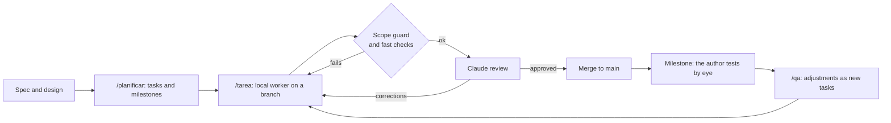

# Local + Claude: is delegating worth it?

[Español](README.md) · **English**

A static site that answers a practical question: *if a local language model does the work and Claude only reviews it, is anything gained compared with using the local model alone, or Claude alone?* It is also the test bench for a second question: *can real software be built with a local model as the worker and Claude as the reviewer?* This very site was built that way.

| Desktop (dark) | Desktop (light) | Mobile |
|---|---|---|
|  |  |  |

> **Important notice.** These scores do not necessarily reflect the real performance of the models, nor are they a precise comparison of using the hybrid model in development. New configurations are still being discovered and, ideally, the data will be updated with better measurements.
>
> The site itself is shown in Spanish by default; use the EN button in the header for English.

## Contents

- [What the site shows](#what-the-site-shows)
- [Results](#results)
- [The experiment: hybrid development](#the-experiment-hybrid-development)
- [Challenges and lessons](#challenges-and-lessons)
- [Achievements](#achievements)
- [Limitations and next steps](#limitations-and-next-steps)
- [How to run it](#how-to-run-it)
- [Repository layout](#repository-layout)

## What the site shows

For each local model tested, **three working modes** are compared on 13 real programming tasks (Unity, web, C++, Unreal, Rust, .NET and Firebase):

1. **Local only:** the local model solves the task without help.
2. **Pair:** the local model works and Claude Haiku reviews it and asks for corrections.
3. **Claude only:** Claude solves the task on its own (the reference).

The focus is on the differences **between the modes inside one model**, not between models: the selector in the header chooses which model you are looking at.

Page sections:

- **Hero:** the conclusion in one sentence and three figures (Claude tokens saved, slowness versus Claude only, and score change from the review).
- **Verdict:** four traffic lights (quality, token savings, equivalent API cost and time) and a *Yes / Depends / No* conclusion computed on the site with thresholds documented in [`src/lib/veredicto.js`](src/lib/veredicto.js).
- **Three modes** and **Difference between modes:** accuracy, speed, Claude tokens and cost, with the difference against Claude only.
- **Detail per task:** a table grouped by scope; each row expands to show Haiku's reviews and the failures.
- **Findings** and **Methodology.**

Spanish and English, light and dark themes, responsive down to mobile. Every figure comes from [`src/data/benchmarks.json`](src/data/benchmarks.json), generated from the original reports in `data/raw/` with `npm run data`; none is typed by hand.

## Results

Data as of 2026-10-16 (5 local models, 13 tasks each, Haiku as the reviewer). Generated from `src/data/benchmarks.json` with the same functions the site uses.

| Local model | Local score | Pair score | Claude score | Claude token savings (pair vs Claude only) | Pair vs Claude only (time) | Verdict |
|---|---|---|---|---|---|---|
| gemma-4-26b-a4b-qat | 8.8 | 10.0 | 9.9 | 73 % | 9× slower | Yes |
| gemma-4-e4b | 8.0 | 8.7 | 10.0 | 67 % | 9× slower | Depends |
| qwen3.8-27b | 9.6 | 9.5 | 10.0 | 78 % | 7× slower | Yes |
| rnj-1-instruct | 5.1 | 7.3 | 10.0 | 70 % | 10× slower | No |
| rnj-1.5-instruct | 4.4 | 4.6 | 10.0 | 79 % | 5× slower | No |

**Quick reading:** with the more capable local models the pair saves between two thirds and four fifths of Claude's tokens without losing quality, at the price of taking 5 to 10 times longer. With the weaker models Claude's review is not enough to make up for it. Read the notice at the top before drawing conclusions.

Verdict thresholds (pair versus Claude only): quality ≤ 0.5 points *good* and ≤ 2 *with reservations*; token savings ≥ 50 % / ≥ 20 %; API cost ≥ 30 % / ≥ 15 %; time ≤ 6× / ≤ 15×. The conclusion is *No* if quality or savings are *bad*, *Yes* if quality and savings are *good* and neither time nor cost is *bad*, and *Depends* otherwise.

## The experiment: hybrid development

This repository is also a case study in **development with a local model as the worker and Claude as director and reviewer**.



- **Division of roles.** The author writes the spec and design, approves tasks and milestones, and tests each milestone by hand. Claude plans, reviews and validates. The local model implements each task.
- **How the worker runs.** A dependency-free Python script ([`.harness/run_worker.py`](.harness/run_worker.py)) launches Claude Code in non-interactive mode against a local server that speaks the Anthropic API (LM Studio / Bionic), through a small proxy that normalises the messages. It creates a branch per task, checks which files were touched against the task's scope, runs the fast checks and hands Claude a short summary for the review.
- **Escalation ladder.** The local model gets 3 attempts; if it fails, the task escalates to Haiku (2), then Sonnet (1) and finally the main Claude session. The first two local attempts run with reasoning stripped (`strip_thinking_attempts = 2`).
- **Small tasks.** At most about 3 files and ~15 lines of specification per task, with a verifiable acceptance criterion.
- **Milestones and QA.** A milestone is a point with complete functionality that the author can test. After each by-eye test, `/qa` turns the observations into tasks, each with its own check (folder [`docs/tasks/qa/`](docs/tasks/qa/)).
- **Memory in files.** The model remembers nothing between sessions: rules live in [`CLAUDE.md`](CLAUDE.md), procedures in [`.claude/skills/`](.claude/skills/), roles in [`.harness/roles/`](.harness/roles/), state in [`docs/progress/progress.md`](docs/progress/progress.md) and what went wrong with the method itself in [`docs/harness-notes.md`](docs/harness-notes.md) (in Spanish).

The full harness map is in [`docs/harness-mapa.md`](docs/harness-mapa.md) (Spanish). The reusable version (core + stacks) is kept in a separate repository, `harness-template`, not yet published.

## Challenges and lessons

What went wrong, and how it was fixed, is documented task by task in [`docs/harness-notes.md`](docs/harness-notes.md) (Spanish). The most relevant points:

- **The local model's output limit.** Tasks that created 3 or 4 new files exhausted the worker's output and ended with no changes. Fix: smaller tasks, one file per write call and stricter retry instructions.
- **Rejected system messages.** Some local models' templates rejected the `system` message that Claude Code adds mid-conversation. Fix: a proxy that moves it into the `system` field.
- **Files outside the scope.** Workers left temporary and debug files behind. Fix: a scope guard that deletes obvious temporaries and flags any unexpected file.
- **Reasoning costs time.** Stripping `thinking` from the requests gave the same quality in 4 tests with two models (19 of 19 hidden tests in both modes) and was 2 to 6 times faster. The third attempt does keep reasoning, as a safety net.
- **Things only a person can see.** A visual conditional instruction ("if it does not fit, make it smaller") cannot be decided by a worker that cannot see the browser: Claude decided it by measuring in Edge. And a dev server with cached CSS made two fixes look as if they had not been applied.
- **Environment.** CRLF line endings that broke a byte-for-byte test, `localhost` resolving to IPv6 and reaching a different program, and test browsers left open.
- **The ladder works.** On a three-file task the local model failed three times without delivering anything and Haiku solved it in under a minute.

## Achievements

- A complete, bilingual site with light and dark themes and colour contrast checked by tests, built with **43 tasks** (plus 13 correction rounds) across **8 milestones**, with **194 automated tests**.
- Five local models compared without touching the code: add a report to `data/raw/` and run `npm run data`.
- A verdict computed on the site itself, with explicit thresholds.
- A repeatable way of working (spec → tasks → worker → scope and checks → review → milestone → QA) with traceability of its own failures, and its reusable version in preparation.

## Limitations and next steps

- The benchmarks are one run per model, with Haiku as the only reviewer and different quantisations per model: they are not a definitive measurement and do not compare models with each other.
- The hybrid-experiment tests use small, well-specified tasks; how the scheme behaves on hard tasks is still to be seen.
- Ideally the data will be updated with better measurements and new configurations.
- Pending: publish the reusable harness template and try it on a second project.

## How to run it

Requires Node.js.

```bash
npm install
npm run dev            # site in development mode
npm test               # tests (Vitest)
npm run build          # production build into dist/
npm run data           # regenerate src/data/benchmarks.json from data/raw/
npm run check:layout   # layout check in Edge and Firefox (with npm run dev running)
```

To run tasks with the local worker again you need a local server with an Anthropic-compatible API at `http://127.0.0.1:1234` and the `claude` command; the settings are in [`.harness/harness.toml`](.harness/harness.toml).

## Repository layout

```text
├─ README.md, README.en.md   front page (Spanish and English)
├─ CLAUDE.md                 permanent project rules (short)
├─ .claude/skills/           procedures: planificar, tarea, qa, resume
├─ .harness/                 unified worker (run_worker.py), config and roles
├─ data/raw/                 original benchmark reports (read-only)
├─ src/                      site: components, styles, es/en texts, generated data
├─ tests/                    tests (Vitest)
├─ scripts/                  data, layout check and helper scripts
└─ docs/                     spec, design, progress, tasks, notes and harness map
```
