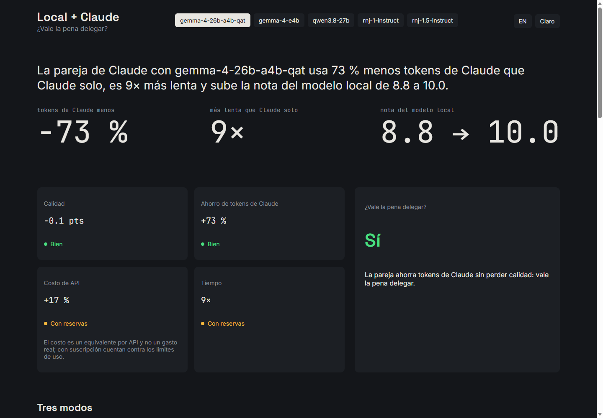
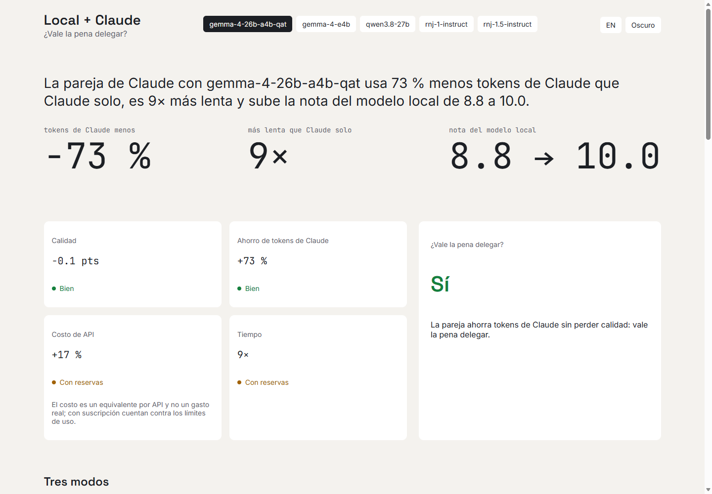
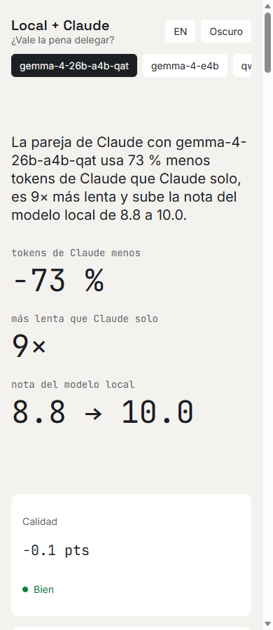
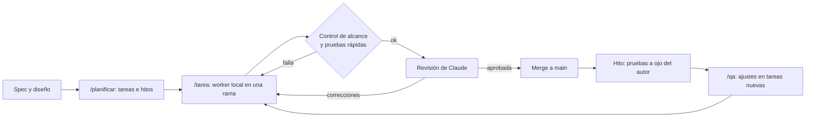

# Local + Claude: ¿vale la pena delegar?

**Español** · [English](README.en.md)

Un sitio estático que responde una pregunta práctica: *si un modelo de lenguaje local hace el trabajo y Claude solo lo revisa, ¿se gana algo frente a usar el modelo local solo o a usar solo Claude?* Y, a la vez, el banco de pruebas de una segunda pregunta: *¿se puede construir software real con un modelo local como obrero y Claude como revisor?* Este mismo sitio se construyó así.

| Escritorio (oscuro) | Escritorio (claro) | Móvil |
|---|---|---|
|  |  |  |

> **Aviso importante.** Estas calificaciones no reflejan necesariamente el desempeño real de los modelos, ni son una comparativa precisa del uso del modelo híbrido en el desarrollo. Se siguen descubriendo configuraciones nuevas y, idealmente, los datos se actualizarán con mediciones mejores.

## Contenido

- [Qué muestra el sitio](#qué-muestra-el-sitio)
- [Resultados](#resultados)
- [El experimento: desarrollo híbrido](#el-experimento-desarrollo-híbrido)
- [Desafíos y aprendizajes](#desafíos-y-aprendizajes)
- [Logros](#logros)
- [Limitaciones y próximos pasos](#limitaciones-y-próximos-pasos)
- [Cómo ejecutarlo](#cómo-ejecutarlo)
- [Estructura del repositorio](#estructura-del-repositorio)

## Qué muestra el sitio

Para cada modelo local probado se comparan **tres modos** de trabajo sobre 13 tareas reales de programación (Unity, web, C++, Unreal, Rust, .NET y Firebase):

1. **Local solo:** el modelo local resuelve la tarea sin ayuda.
2. **Pareja:** el modelo local trabaja y Claude Haiku revisa y pide correcciones.
3. **Claude solo:** Claude resuelve la tarea por su cuenta (la referencia).

El foco está en las diferencias **entre los modos dentro de un mismo modelo**, no entre modelos: el selector del encabezado elige qué modelo se está mirando.

Secciones de la página:

- **Hero:** la conclusión en una frase y tres cifras (tokens de Claude ahorrados, lentitud frente a Claude solo y cambio de nota por la revisión).
- **Veredicto:** cuatro semáforos (calidad, ahorro de tokens, costo de API equivalente y tiempo) y una conclusión *Sí / Depende / No* calculada en el propio sitio con umbrales documentados en [`src/lib/veredicto.js`](src/lib/veredicto.js).
- **Tres modos** y **Diferencia entre modos:** precisión, velocidad, tokens de Claude y costo, con la diferencia frente a Claude solo.
- **Detalle por tarea:** tabla agrupada por ámbito; cada fila se expande para ver las revisiones de Haiku y los fallos.
- **Hallazgos** y **Metodología.**

Español e inglés, tema claro y oscuro, adaptable a móvil. Todas las cifras salen de [`src/data/benchmarks.json`](src/data/benchmarks.json), que se genera a partir de los reportes originales en `data/raw/` con `npm run data`; ninguna se escribe a mano.

## Resultados

Datos a 2026-10-16 (5 modelos locales, 13 tareas cada uno, Haiku como revisor). Generados desde `src/data/benchmarks.json` con las mismas funciones que usa el sitio.

| Modelo local | Nota local | Nota pareja | Nota Claude | Ahorro de tokens de Claude (pareja vs Claude solo) | Pareja vs Claude solo (tiempo) | Veredicto |
|---|---|---|---|---|---|---|
| gemma-4-26b-a4b-qat | 8.8 | 10.0 | 9.9 | 73 % | 9× más lenta | Sí |
| gemma-4-e4b | 8.0 | 8.7 | 10.0 | 67 % | 9× más lenta | Depende |
| qwen3.8-27b | 9.6 | 9.5 | 10.0 | 78 % | 7× más lenta | Sí |
| rnj-1-instruct | 5.1 | 7.3 | 10.0 | 70 % | 10× más lenta | No |
| rnj-1.5-instruct | 4.4 | 4.6 | 10.0 | 79 % | 5× más lenta | No |

**Lectura rápida:** con los modelos locales más capaces, la pareja ahorra entre dos tercios y cuatro quintos de los tokens de Claude sin perder calidad, a cambio de tardar de 5 a 10 veces más. Con los modelos débiles, la revisión de Claude no alcanza para compensar. Lee el aviso del inicio antes de sacar conclusiones.

Umbrales del veredicto (pareja frente a Claude solo): calidad ≤ 0,5 puntos *bien* y ≤ 2 *con reservas*; ahorro de tokens ≥ 50 % / ≥ 20 %; costo de API ≥ 30 % / ≥ 15 %; tiempo ≤ 6× / ≤ 15×. La conclusión es *No* si calidad o ahorro están en *mal*, *Sí* si calidad y ahorro están en *bien* y ni tiempo ni costo están en *mal*, y *Depende* en el resto.

## El experimento: desarrollo híbrido

Este repositorio es también un caso de estudio de **desarrollo con un modelo local como obrero (*worker*) y Claude como director y revisor**.



- **Reparto de roles.** El autor define la spec y el diseño, aprueba tareas e hitos y prueba cada hito a mano. Claude planifica, revisa y valida. El modelo local implementa cada tarea.
- **Cómo se ejecuta el worker.** Un script de Python sin dependencias ([`.harness/run_worker.py`](.harness/run_worker.py)) lanza Claude Code en modo no interactivo contra un servidor local compatible con la API de Anthropic (LM Studio / Bionic), a través de un pequeño proxy que normaliza los mensajes. Crea una rama por tarea, revisa qué archivos se tocaron frente al alcance de la tarea, ejecuta las pruebas rápidas y devuelve a Claude un resumen corto para la revisión.
- **Escalera de intentos.** El modelo local tiene 3 intentos; si falla, escala a Haiku (2), luego a Sonnet (1) y por último a la sesión principal de Claude. En los dos primeros intentos locales se quita el razonamiento (`strip_thinking_attempts = 2`).
- **Tareas pequeñas.** Máximo unos 3 archivos y ~15 líneas de especificación por tarea, con un criterio de aceptación verificable.
- **Hitos y QA.** Un hito es un punto con funcionalidad completa que el autor puede probar. Tras cada prueba a ojo, `/qa` convierte las observaciones en tareas con su comprobación (carpeta [`docs/tasks/qa/`](docs/tasks/qa/)).
- **Memoria en archivos.** El modelo no recuerda entre sesiones: las reglas viven en [`CLAUDE.md`](CLAUDE.md), los procedimientos en [`.claude/skills/`](.claude/skills/), los roles en [`.harness/roles/`](.harness/roles/), el estado en [`docs/progress/progress.md`](docs/progress/progress.md) y lo que falló del propio método en [`docs/harness-notes.md`](docs/harness-notes.md).

El mapa completo del harness está en [`docs/harness-mapa.md`](docs/harness-mapa.md). La versión reutilizable (núcleo + stacks) se mantiene en un repositorio aparte, `harness-template`, todavía sin publicar.

## Desafíos y aprendizajes

Lo que salió mal (y cómo se corrigió) está documentado tarea por tarea en [`docs/harness-notes.md`](docs/harness-notes.md). Lo más relevante:

- **El límite de salida del modelo local.** Las tareas que creaban 3 o 4 archivos nuevos agotaban la salida del worker y terminaban sin cambios. Remedio: partir en tareas más pequeñas, un archivo por llamada de escritura y reintentos con instrucciones más estrictas.
- **Mensajes de sistema rechazados.** La plantilla de algunos modelos locales rechazaba el mensaje `system` que Claude Code añade a mitad de la conversación. Remedio: un proxy que lo mueve al campo `system`.
- **Archivos fuera de alcance.** Los workers dejaban temporales y depuración. Remedio: un control de alcance que borra los temporales evidentes y avisa de cualquier archivo no previsto.
- **El razonamiento cuesta tiempo.** Quitar `thinking` de las peticiones dio la misma calidad en 4 pruebas con dos modelos (19 de 19 pruebas ocultas en ambos modos) y entre 2 y 6 veces más rapidez. La tercera oportunidad sí lleva razonamiento, como red de seguridad.
- **Cosas que solo ve una persona.** Una instrucción condicional visual ("si no cabe, baja el tamaño") no la puede decidir un worker que no ve el navegador: la decidió Claude midiendo en Edge. Y un servidor de desarrollo con CSS cacheado hizo creer que dos correcciones no se habían aplicado.
- **Entorno.** Saltos de línea CRLF que rompían una prueba byte a byte, `localhost` que resolvía a IPv6 y llegaba a otro programa, y navegadores de pruebas que se quedaban abiertos.
- **La escalera sirve.** En una tarea de tres archivos el modelo local falló tres veces sin entregar nada y Haiku la resolvió en menos de un minuto.

## Logros

- Un sitio completo, bilingüe, con tema claro y oscuro y contraste de color comprobado por pruebas, construido con **43 tareas** (más 13 rondas de corrección) en **8 hitos**, con **194 pruebas** automáticas.
- Cinco modelos locales comparados sin tocar el código: agregar un reporte a `data/raw/` y ejecutar `npm run data` basta.
- Un veredicto calculado en el propio sitio, con umbrales explícitos.
- Un método de trabajo repetible (spec → tareas → worker → alcance y pruebas → revisión → hito → QA) con trazabilidad de sus fallos, y su versión reutilizable en preparación.

## Limitaciones y próximos pasos

- Los benchmarks son una ejecución por modelo, con Haiku como único revisor y cuantizaciones distintas por modelo: no son una medición definitiva ni comparan modelos entre sí.
- Las pruebas del experimento híbrido usan tareas pequeñas y bien especificadas; falta ver cómo se comporta el esquema con tareas difíciles.
- Idealmente los datos se actualizarán con mediciones mejores y nuevas configuraciones.
- Pendiente: publicar la plantilla reutilizable del harness y probarla en un segundo proyecto.

## Cómo ejecutarlo

Requiere Node.js.

```bash
npm install
npm run dev            # sitio en modo desarrollo
npm test               # pruebas (Vitest)
npm run build          # build de producción en dist/
npm run data           # regenera src/data/benchmarks.json desde data/raw/
npm run check:layout   # revisa el layout en Edge y Firefox (con npm run dev activo)
```

Para volver a ejecutar tareas con el worker local hace falta un servidor local con API compatible con Anthropic en `http://127.0.0.1:1235` y el comando `claude`; los ajustes están en [`.harness/harness.toml`](.harness/harness.toml).

## Estructura del repositorio

```text
├─ README.md, README.en.md   portada (este archivo y su versión en inglés)
├─ CLAUDE.md                 reglas permanentes del proyecto (cortas)
├─ .claude/skills/           procedimientos: planificar, tarea, qa, resume
├─ .harness/                 worker unificado (run_worker.py), config y roles
├─ data/raw/                 reportes originales de los benchmarks (solo lectura)
├─ src/                      sitio: componentes, estilos, textos es/en, datos generados
├─ tests/                    pruebas (Vitest)
├─ scripts/                  datos, comprobación de layout y scripts auxiliares
└─ docs/                     spec, diseño, progreso, tareas, notas y mapa del harness
```
